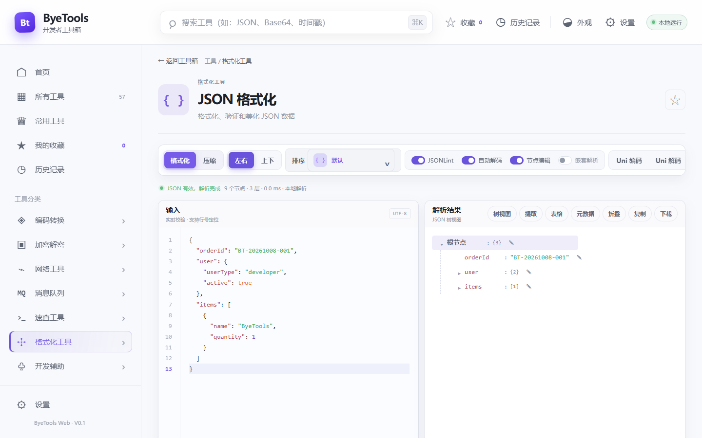
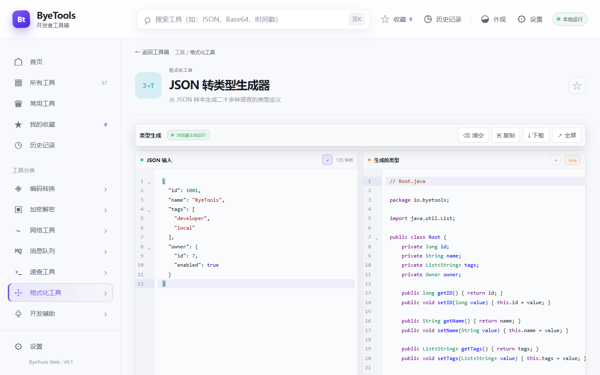
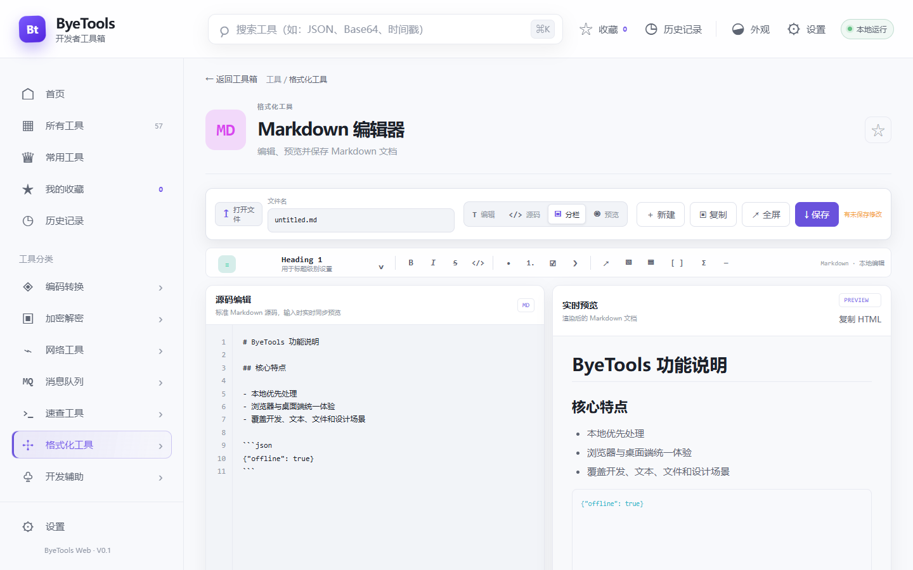
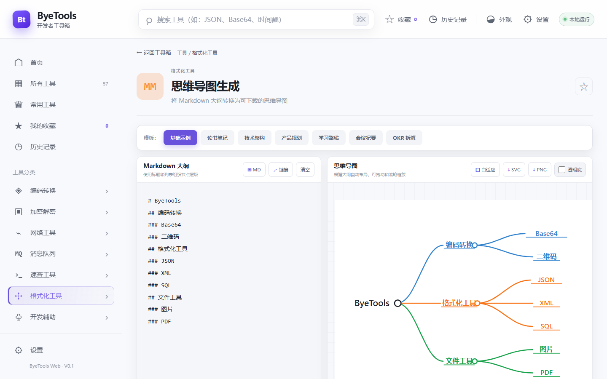
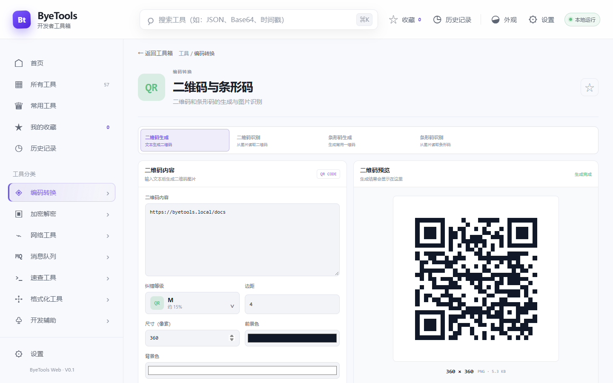
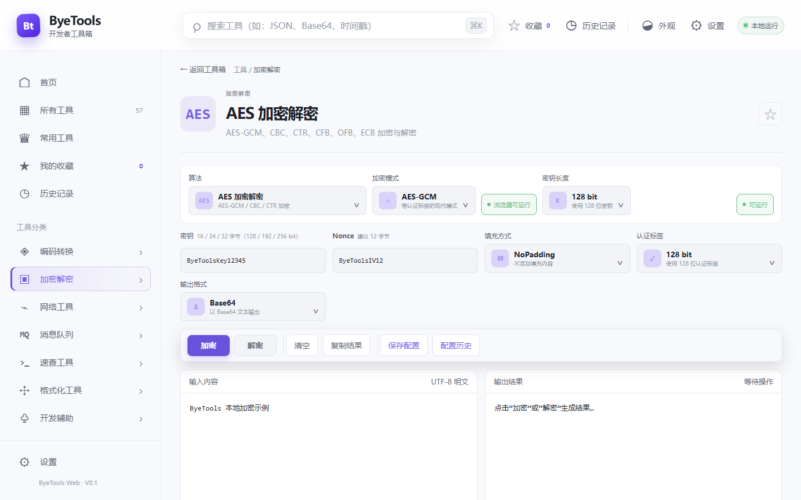
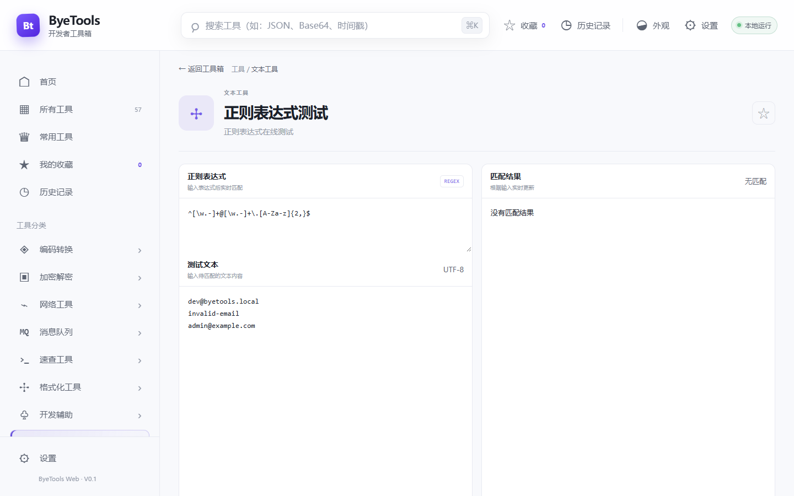
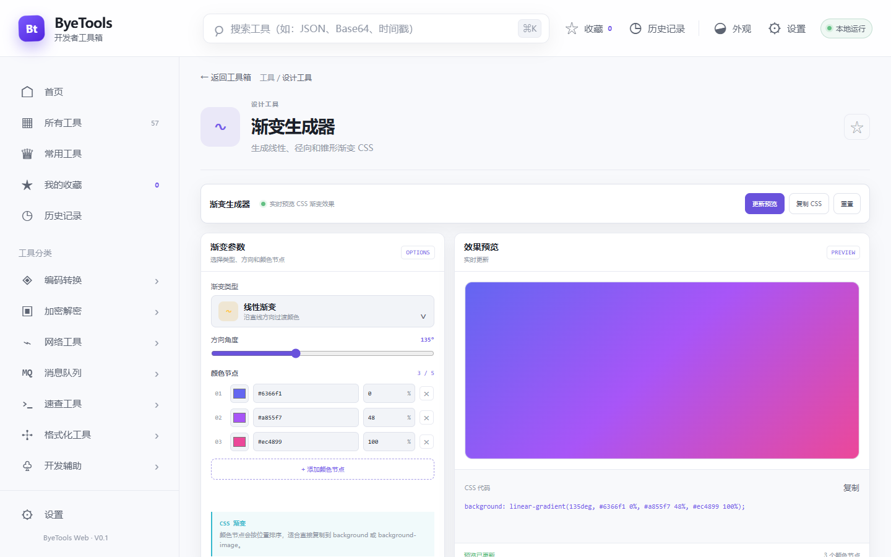
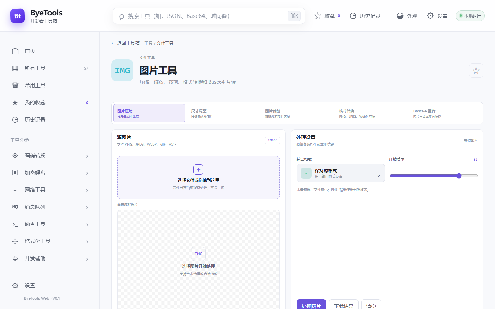
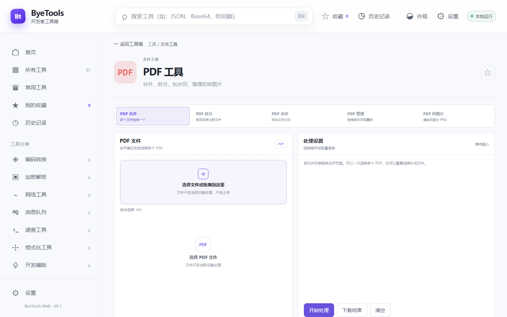

# ByeTools 功能说明文档

> 文档版本：V1.0  
> 对应应用版本：ByeTools 0.1.0  
> 代码基线：`15a82fd`  
> 更新日期：2026-10-08  
> 功能范围：以当前 `project-code` 中已经实现并可进入的 57 个工具为准。

## 1. 产品概述

ByeTools 是一套面向开发、测试、运维和日常数据处理的本地优先工具箱。应用提供 Web 页面和 Tauri 桌面客户端两种运行方式，覆盖格式化、编码转换、加密解密、网络、消息队列、命令速查、文本处理、设计辅助、随机生成和文件处理等场景。

核心特点：

- 无需注册或登录，进入应用即可使用。
- 大部分数据转换在当前设备完成，不上传输入内容。
- 统一的工具目录、全局搜索、分类筛选、收藏和历史记录。
- 同时支持浅色和深色主题、菜单布局与内容密度调整。
- 桌面端提供加密存储和真实消息队列连接能力。
- 工作区采用一致的输入、参数、执行、复制和下载交互。


## 2. 运行环境与数据边界

| 能力类型 | Web 版 | Tauri 桌面版 | 数据说明 |
| --- | --- | --- | --- |
| 文本、编码、格式化、摘要、生成器 | 支持 | 支持 | 默认在当前设备处理 |
| 图片、PDF、二维码与条形码 | 支持 | 支持 | 文件在当前设备内读取和生成 |
| 公网 IP 归属地 | 支持联网查询 | 支持联网查询 | 仅公网 IP 会发送到归属地服务；本地、回环地址不发送 |
| MQTT、Kafka、RabbitMQ、RocketMQ | 仅配置、编辑和校验 | 支持测试连接、发送和消费 | 真实 MQ 操作仅在桌面端执行 |
| 偏好、收藏、历史、草稿 | 浏览器本地存储 | SQLCipher SQLite | 桌面数据库密钥保存在系统凭证存储中 |
| 加密工具配置 | 当前设备保存 | 加密后写入 SQLCipher | 配置列表仅展示掩码摘要，敏感正文按需解密 |

说明：本文截图使用 Web 版浅色主题采集。桌面端使用相同的前端界面，但会额外启用桌面状态标识、真实消息队列连接及桌面安全存储。

## 3. 首页与通用操作

### 3.1 工具导航

首页左侧按功能划分为 11 个分类，当前共收录 57 个工具。点击分类可直接筛选，也可以进入“所有工具”查看完整目录。

| 分类 | 数量 | 主要内容 |
| --- | ---: | --- |
| 格式化工具 | 9 | JSON、XML、SQL、Markdown、Mermaid、思维导图 |
| 编码转换 | 5 | Base64、URL、Unicode、HTML、二维码与条形码 |
| 加密解密 | 10 | MD5、SHA、国密、AES、DES、3DES、RSA |
| 网络工具 | 2 | IP 查询、Curl 转代码 |
| 消息队列 | 1 | MQTT、Kafka、RabbitMQ、RocketMQ |
| 速查工具 | 1 | Linux 命令速查 |
| 开发辅助 | 7 | 时间、时区、日期、JWT、Cron、颜色、世界时钟 |
| 文本工具 | 8 | 正则、对比、统计、转换、替换、清理、行操作 |
| 设计工具 | 5 | 渐变、阴影、对比度、调色板、尺寸换算 |
| 生成器 | 6 | 随机数、密码、UUID、字符串、Slug、假数据 |
| 文件工具 | 3 | 图片、Favicon、PDF |


### 3.2 全局搜索与筛选

1. 在顶部搜索框输入工具名、英文缩写或关键词，例如 `JSON`、`Base64`、`时间戳`。
2. 可使用运行环境筛选，只查看本地工具或需要桌面能力增强的工具。
3. 支持推荐排序、按名称排序和按分类排序。
4. 页面中的分类标签可以快速缩小工具范围。
5. 无匹配结果时可重置搜索和筛选条件。

### 3.3 收藏与历史

- 点击工具卡片或工作区右上角的星标可加入或取消收藏。
- “我的收藏”集中展示已标记工具。
- 打开工具后会进入“历史记录”，便于回到最近使用的工作区。
- 收藏、历史和外观设置均保存在当前设备。

### 3.4 外观设置

- 主题：跟随系统、浅色、深色。
- 菜单布局：标准布局和紧凑布局。
- 内容密度：舒适、紧凑等显示密度。
- 设置立即生效，并在下次启动时恢复。

## 4. 格式化工具

### 4.1 JSON 格式化

JSON 格式化提供带行号和语法高亮的输入区，以及树、提取、表格和元数据等结果视图。

主要操作：

1. 粘贴 JSON 后点击“格式化”或“压缩”。
2. 在“左右”和“上下”之间切换工作区布局。
3. 按默认、键名升序或键名降序整理对象字段。
4. 开关 JSONLint、自动解码、节点编辑和嵌套解析。
5. 在树视图展开节点，编辑节点值，或提取当前节点。
6. 切换表格和元数据视图，查看结构化统计。
7. 复制当前选中文本、树节点或完整结果，也可下载结果文件。
8. 使用 Unicode 编码和解码处理转义内容。

输入区和语法高亮层保持一一对齐，鼠标选中字段后执行复制，得到的内容与可见选区一致。



### 4.2 JSON 转类型生成器

粘贴 JSON 样本后，工具会分析嵌套对象、数组、数字、布尔值、日期和可选字段，并生成对应语言的类型声明。

- 内置代码编辑器、行号、语法高亮和自动换行。
- 支持 TypeScript、Java、Go、Rust、Swift、Kotlin、Python、C#、C++ 等二十多种目标语言。
- 可设置根类型名、日期推断、字典推断、枚举推断、全部可选和字段排序。
- 不同语言提供包名、命名空间、集合类型、框架、可见性等专属选项。
- 支持打开本地 JSON 文件、载入示例、复制、下载和全屏查看。



### 4.3 其他格式化工具

| 工具 | 输入与设置 | 主要输出与操作 |
| --- | --- | --- |
| XML 格式化 | XML 文本或本地文件 | 实时校验；格式化或压缩；支持属性、嵌套节点和命名空间；复制、下载、全屏 |
| XML 转换器 | XML 文本或文件；目标格式、缩进、属性前缀、命名空间与数组选项 | 转换为 JSON、YAML、TOML、JavaScript 对象或 PHP 数组；复制和下载 |
| SQL 格式化 | SQL 文本；MySQL、PostgreSQL、SQLite、SQL Server 方言 | 格式化或压缩；控制关键字大小写、缩进、逻辑运算符换行和语句空行；不会执行 SQL |
| Mermaid 图表 | Mermaid 流程图或关系图代码 | 本地渲染 SVG 预览；复制或下载 SVG |
| Markdown 转图片 | Markdown 内容、主题和字号 | 实时排版预览；导出 PNG 分享图 |
| Markdown 编辑器 | Markdown 源码或本地文件 | 编辑、源码、分栏、预览四种视图；格式工具栏；复制 Markdown/HTML；全屏与保存 |
| 思维导图生成 | Markdown 标题和列表大纲 | 自动布局思维导图；拖动和缩放；内置模板；导出 SVG 或 PNG；支持透明背景 |



Markdown 编辑器支持标题、粗体、斜体、删除线、行内代码、列表、任务、引用、链接、图片、表格、代码块、公式和分隔线等快捷插入。可以打开本地 `.md`、`.markdown` 或文本文件，继续编辑后按指定文件名保存。



## 5. 编码转换

| 工具 | 主要能力 | 使用说明 |
| --- | --- | --- |
| Base64 编解码 | UTF-8 文本与 Base64 双向转换 | 输入文本后选择编码或解码，结果可复制 |
| URL 编解码 | URL 百分号编码与解码 | 适合查询参数、路径片段和接口调试 |
| Unicode 编解码 | 普通文本与 Unicode 转义双向转换 | 处理 `\uXXXX` 等转义内容 |
| HTML 转换 | HTML 实体编码与解码 | 支持中文、标签、引号和特殊字符；结果可复制 |
| 二维码与条形码 | 生成和识别二维码、条形码 | 四种模式在同一工作区切换，图片在当前设备处理 |

### 5.1 二维码与条形码

- 二维码生成：输入文本、URL 或 JSON，设置纠错等级、边距、尺寸、前景色和背景色，生成并下载 PNG。
- 二维码识别：选择常见图片格式，识别后复制文本结果。
- 条形码生成：支持 Code 128、Code 39、EAN-13、EAN-8、UPC-A、ITF-14 和 Codabar，可设置缩放、高度、颜色和显示文本。
- 条形码识别：读取清晰完整的条码图片并输出编码内容。



## 6. 加密解密

加密工具采用统一工作区，可从算法选择器切换算法。摘要工具输出哈希值；对称算法提供模式、密钥、IV/Nonce、填充和输出编码；非对称算法提供密钥对管理。



| 工具 | 算法与参数 | 说明 |
| --- | --- | --- |
| MD5 摘要 | MD5 | 仅用于兼容或校验，不应用于密码存储和安全签名 |
| SHA-2 摘要 | SHA-256、SHA-384、SHA-512 | 输入文本并生成十六进制摘要 |
| SHA-3 摘要 | SHA3-256、SHA3-384、SHA3-512 | 浏览器本地生成摘要 |
| SM2 加密解密 | C1C3C2、C1C2C3；04 前缀；ASN.1 DER | 生成公私钥对、由私钥推导公钥、公钥加密和私钥解密 |
| SM3 摘要 | SM3 | 国密摘要计算 |
| SM4 加密解密 | CBC、ECB、CTR、CFB、OFB | 密钥和 IV 默认按 UTF-8 原文输入，也可切换编码并随机生成 |
| AES 加密解密 | GCM、CBC、CTR、CFB、OFB、ECB | 支持 128/192/256 位密钥；不同模式自动提示 IV、Nonce、填充和认证标签要求 |
| DES 加密解密 | CBC、ECB | 仅为旧系统兼容保留，不推荐用于新系统 |
| 3DES 加密解密 | CBC、ECB | 支持 PKCS#5/PKCS#7 和 NoPadding；仅用于兼容旧系统 |
| RSA 加密解密 | RSA-OAEP、RSAES-PKCS#1 v1.5 | 生成 2048 位 PEM 密钥对；支持 SHA-256、SHA-384、SHA-512；公钥加密、私钥解密 |

通用注意事项：

- AES、SM4、DES、3DES 的密钥和 IV 长度必须满足所选算法要求。
- ECB 不使用 IV，且无法隐藏重复数据块，不建议用于新设计。
- GCM 模式除密文外还包含认证标签，解密时参数必须一致。
- RSA 只能加密受密钥长度限制的短消息，大文本应使用“对称加密数据 + RSA 加密对称密钥”的混合方案。
- 桌面端可保存、查询、应用、更新和删除加密配置，敏感字段在配置列表中以掩码展示。

## 7. 网络工具

### 7.1 IP 查询

- 本地识别 IPv4、IPv6、内网、公网、回环和链路本地地址。
- 内网、回环和链路本地地址不会请求外部服务。
- 公网地址可查询国家、地区、城市、运营商、ASN、时区和坐标。
- 归属地来自 IPQuery 或 FreeIPAPI，仅用于网络排查，不能作为精确定位结果。

### 7.2 Curl 转代码

- 解析 Curl URL、请求方法、请求头和请求体。
- 输出 Fetch、Axios、Python 或 Go 请求代码。
- 显示解析摘要，支持复制生成代码和清空输入。
- 转换在当前设备完成，不会实际发送该 HTTP 请求。

## 8. 消息队列

消息中间件工作区将连接配置、消息编辑、操作按钮和消费日志集中在同一页面。操作按钮固定在顶部，配置完成后无需滚回页面顶端寻找执行入口。


### 8.1 支持的中间件

| 类型 | 连接和目标参数 | 桌面端能力 |
| --- | --- | --- |
| MQTT | Broker、端口、用户名、密码、TLS、Topic、QoS、Retain | 测试连接、发布、订阅消费、停止消费 |
| Kafka | Broker 列表、认证、TLS、Topic、Group 等 | 测试连接、生产消息、消费者组消费 |
| RabbitMQ | 地址、认证、TLS、Exchange、Queue、Routing Key | 测试连接、发送、队列消费；Exchange、Queue 和绑定关系需提前创建 |
| RocketMQ | 5.x Proxy Endpoint、AccessKey、SecretKey、Topic、Consumer Group、Tag | 测试连接、发送、消费和停止消费者 |

### 8.2 配置和消息管理

1. 填写配置名称并保存连接参数。
2. 点击“查询配置”查看当前设备中的配置记录。
3. 选择历史配置后应用到当前表单，也可更新或删除。
4. 消息正文支持文本和 JSON 两种模式，JSON 可格式化。
5. 顶部可执行测试连接、发送消息、开始消费、停止消费和清空。
6. 日志记录时间、方向、状态、中间件和内容摘要。
7. 已消费消息可以导出为 Excel 兼容文件，便于审计和分析。

Web 版只提供配置、编辑和本地校验，不会伪造 MQ 成功结果。真实连接、发送与消费必须使用 Tauri 桌面版。

## 9. 速查工具

Linux 命令速查包含 75 条常用命令，可按文件与目录、文本处理、系统信息、进程任务、网络诊断、磁盘存储、用户权限等场景浏览。

- 支持按命令名、用途和中文关键词搜索。
- 显示命令用途、基础语法、风险提示、常用参数和使用示例。
- 基础语法和示例可一键复制。
- 点击相关命令可继续跳转查阅。
- 工具只展示命令资料，不执行命令，也不要求额外验证。


## 10. 开发辅助

| 工具 | 主要能力 | 结果与说明 |
| --- | --- | --- |
| 时间戳转换 | 时间戳转时间、时间转时间戳、时长单位换算 | 支持秒/毫秒自动识别，本地时间与 UTC，毫秒到年的 8 种时长单位 |
| 颜色转换 | 输入 HEX、HEXA、RGB、RGBA、HSL、HSLA 或使用取色器 | 输出 HEX、RGB、HSL、HSV 和 CSS 变量，可逐项复制 |
| JWT 解析 | 粘贴 JWT 或载入示例 | 解码 Header、Payload，展示签发和过期时间；不校验服务端签名 |
| Cron 表达式 | 编辑和校验 Cron 字段 | 展示字段含义、表达式说明和后续执行时间，适合定时任务配置检查 |
| 时区转换器 | 选择源时区、目标时区和时间 | 换算同一时刻在不同时区的本地时间 |
| 日期计算器 | 日期差值、日期加减 | 输出天数等差值或计算后的目标日期 |
| 世界时钟 | 常用城市和时区 | 实时显示多个城市的当前时间，可切换显示格式和秒数 |

## 11. 文本工具

### 11.1 正则表达式测试

输入表达式和测试文本后实时显示匹配结果。页面提供可折叠的常用正则表达式和核心语法速查，选择常用模板后可直接带入表达式，避免辅助内容挤占测试区域。



### 11.2 其他文本工具

| 工具 | 主要能力 |
| --- | --- |
| 文本对比 | 对比普通文本、JSON 和 Properties，展示新增、删除和变更内容 |
| 文本统计 | 统计字符、非空字符、词数、行数和 UTF-8 字节数 |
| 大小写转换 | camelCase、PascalCase、snake_case、kebab-case 等命名风格互转 |
| 文本替换 | 普通文本或正则表达式批量查找替换，显示匹配和替换统计 |
| 文本清理 | 清理首尾空白、多余空格、空行及不可见字符 |
| 行操作工具 | 去重、排序、反转、编号、过滤和空行处理 |
| 不可见字符查看器 | 标记空格、制表符、换行和零宽字符，列出字符位置和编码 |

## 12. 设计工具

| 工具 | 主要能力 | 输出 |
| --- | --- | --- |
| 渐变生成器 | 线性、径向、锥形渐变；调整角度、色标和位置 | 实时预览并复制 CSS |
| 阴影生成器 | 调整水平/垂直偏移、模糊、扩散、颜色和多层阴影 | 实时预览并复制 `box-shadow` |
| 对比度检查 | 输入或选择前景色和背景色 | 计算 WCAG 对比度，判断普通文本和大号文本 AA/AAA 等级 |
| 调色板生成器 | 从一个基础色生成主题色阶 | 生成多级颜色，可复制单色或整组变量 |
| px / rem 换算器 | 设置根字号并输入 px、rem 或 em | 双向换算 CSS 尺寸 |



## 13. 生成器

| 工具 | 可配置内容 | 输出与导出 |
| --- | --- | --- |
| 随机数生成 | 整数、小数、布尔值、UUID、十六进制、Base64、日期、颜色、IP 等 | 批量生成、复制、CSV 导出 |
| 密码生成器 | 长度、数量、大小写、数字、符号和排除易混淆字符 | 强度提示、批量复制、CSV 导出 |
| UUID 生成器 | 数量、大小写、连接符和显示格式 | 批量 UUID、复制、CSV 导出 |
| 随机字符串生成器 | 长度、数量、自定义字符集和常用字符集合 | 批量字符串、复制、CSV 导出 |
| Slug 生成器 | 分隔符、最大长度、小写和保留中文 | 生成适用于 URL、文件名或 CSS 类名的 Slug |
| 假数据生成器 | 用户、地址、公司、商品、订单等类型及数量 | 生成 JSON/表格测试数据，并支持复制或 CSV 导出 |

随机类工具使用当前环境提供的安全随机源生成结果；生成内容应按业务安全要求决定是否直接用于生产环境。

## 14. 文件工具

### 14.1 图片工具

图片工具把五类相近操作整合在同一工作区，通过顶部模式切换。

- 图片压缩：调整输出质量，在预览中比较原始和处理后大小。
- 图片尺寸调整：设置宽高、缩放方式和是否保持比例。
- 图片裁剪：在图片上拖动和调整裁剪框；支持自由比例、常见固定比例、位置和尺寸精确输入、旋转与翻转，以及指定导出尺寸。
- 图片格式转换：输出 PNG、JPEG、WebP 或 AVIF；浏览器不支持 AVIF 时回退为 PNG。
- 图片与 Base64：图片转 Data URL，或将 Data URL/纯 Base64 恢复成图片。



### 14.2 Favicon 生成器

- 选择一张本地图片作为图标源。
- 预览不同网站图标尺寸。
- 生成常用尺寸 PNG、Apple Touch Icon、ICO 和站点清单相关资源。
- 下载生成结果，用于网站或桌面快捷方式。

### 14.3 PDF 工具

| 模式 | 操作说明 | 输出 |
| --- | --- | --- |
| PDF 合并 | 选择多个 PDF，按文件列表顺序合并 | 单个合并 PDF |
| PDF 拆分 | 输入页码、范围或逗号组合，如 `1-3,5` | 按选择生成拆分结果 |
| PDF 加水印 | 设置文字、字号、透明度、颜色和旋转角度 | 每页带居中水印的新 PDF |
| PDF 整理 | 通过页码顺序重排、重复或删除页面 | 重新组织后的 PDF |
| PDF 转图片 | 选择页码和 1× 至 3× 清晰度 | 每页生成一张 PNG |

PDF 文件通过 `pdf-lib` 和 `pdfjs-dist` 在当前设备解析和生成，不上传原始文件。



## 15. 常见使用流程

### 15.1 格式化一段 JSON 并复制字段

1. 打开“JSON 格式化”。
2. 将 JSON 粘贴到左侧输入区。
3. 点击“格式化”，确认状态显示“JSON 有效”。
4. 在输入区直接拖选所需文本，按 `Ctrl+C` 复制；或在树视图选择节点后点击“复制”。
5. 需要完整文件时点击“下载”。

### 15.2 从 JSON 生成 Java 类型

1. 打开“JSON 转类型生成器”。
2. 粘贴接口响应样本，或打开本地 JSON 文件。
3. 将目标语言选择为 Java，填写根类型名和包名。
4. 根据项目决定使用数组或 `List<T>`、日期类型及 Lombok。
5. 复制生成代码或下载文件后放入项目。

### 15.3 制作二维码

1. 打开“二维码与条形码”，选择“二维码生成”。
2. 输入网址或文本，设置纠错等级、边距和尺寸。
3. 点击“生成二维码”。
4. 扫码检查内容，确认无误后下载 PNG。

### 15.4 在桌面端发送 MQ 消息

1. 启动 Tauri 桌面客户端并打开“消息中间件”。
2. 选择 MQTT、Kafka、RabbitMQ 或 RocketMQ。
3. 填写连接、认证和消息目标参数。
4. 点击“测试连接”，确认成功后再发送或开始消费。
5. 在日志区查看结果；消费完成后点击“导出消费消息”。
6. 不再使用消费者时点击“停止消费”。

## 16. 使用限制与安全提示

- MD5、DES、3DES 和 AES-ECB 仅用于兼容，不建议用于新系统安全设计。
- JWT 解析只解码令牌内容，不等同于签名校验或身份认证。
- SQL 格式化只整理文本，不连接数据库、不执行 SQL。
- Linux 命令速查只提供资料，复制后应理解命令含义并在终端中确认目标路径和参数。
- 公网 IP 查询依赖第三方归属地服务和网络状态，结果仅供参考。
- MQ 的密码、SecretKey 等凭证应使用最小权限账户，并避免写入消息正文和截图。
- 浏览器下载行为受浏览器权限和下载策略影响；桌面版文件保存受操作系统权限控制。
- 处理重要图片或 PDF 前建议保留原始文件，避免覆盖唯一副本。

## 17. 文档维护

功能截图由以下脚本生成：

```powershell
npm run dev
npm run docs:screenshots
```

截图输出目录：

```text
docs/images/功能说明/
```

新增、删除或修改工具后，应同步更新：

1. 本文的工具数量与分类统计。
2. 对应分类中的工具说明和运行边界。
3. 受影响的操作流程与安全提示。
4. 代表性截图；截图中不得包含真实密码、密钥、Token 或内部地址。
